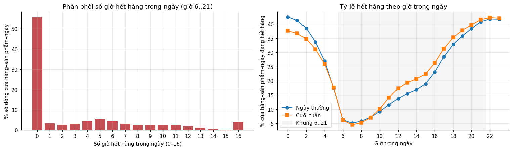
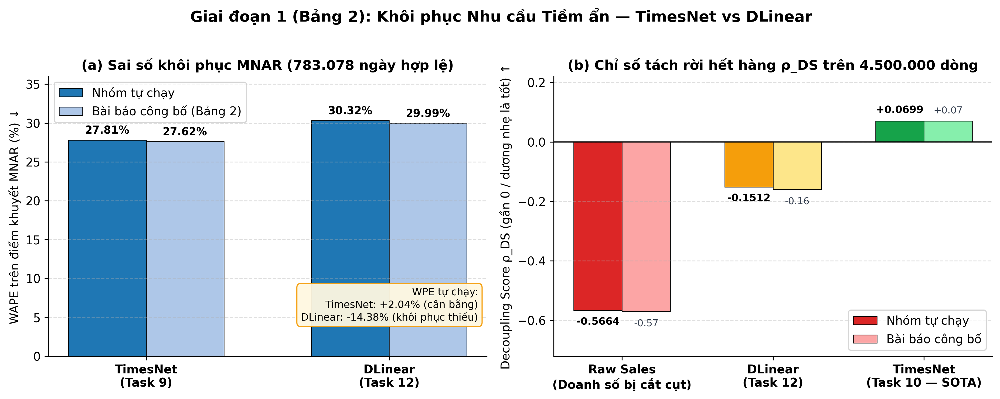
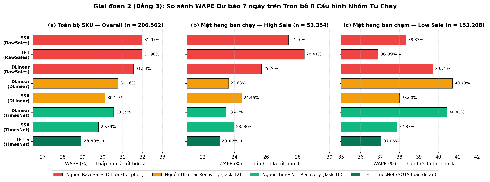
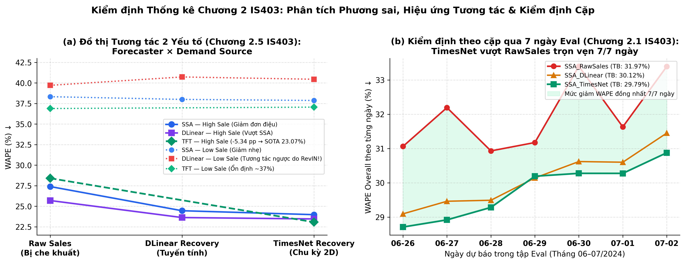
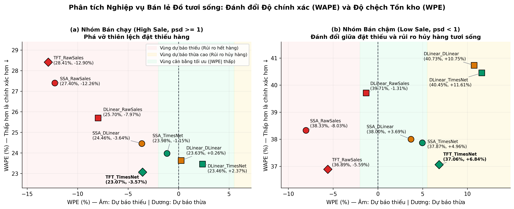
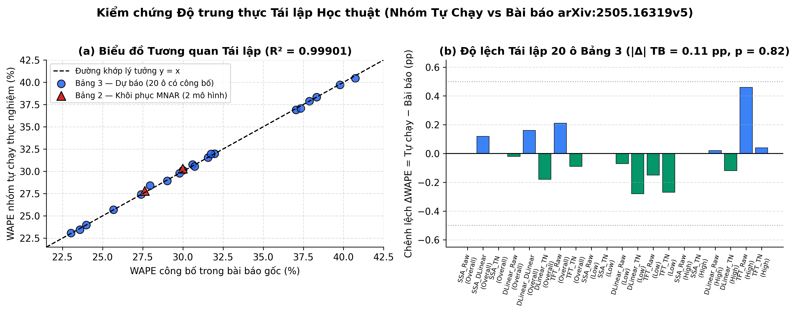
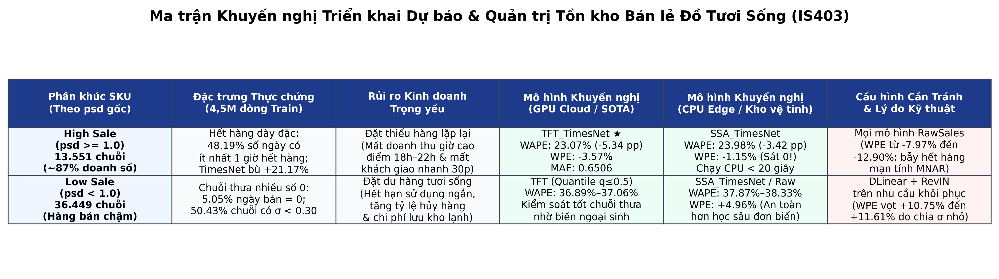

# TÁI LẬP & MỞ RỘNG THỰC NGHIỆM FRESHRETAILNET-50K
### Khôi phục Nhu cầu Tiềm ẩn (MNAR) & Dự báo Kháng Hết hàng trong Bán lẻ Đồ Tươi Sống

- **Môn học:** Phân tích Dữ liệu Kinh doanh (`IS403` — UIT, ĐHQG-HCM)
- **Bài báo gốc:** *FreshRetailNet-50K* (Dingdong Ltd., `arXiv:2505.16319v5`)
- **Nhóm thực hiện (16/16 Task):** Phạm Đăng Khoa • Dương Trọng Toàn • Sinhvienvuitinh • Khanh • Minh Nguyễn
- **Repository:** `https://github.com/dangkhoauit184/PTDLKD`

---

## Slide 2 — Bối cảnh Kinh doanh & Bẫy Dữ liệu Khuyết MNAR

- **Đặc thù kho vệ tinh giao nhanh 30 phút (Dark Store):** Hạn sử dụng cực ngắn (1–3 ngày), diện tích kệ hạn chế, nhu cầu biến động mạnh theo giờ/thời tiết/khuyến mãi.
- **Hiện tượng che khuất nhu cầu (*Demand Censoring*):**
  $$y_t = \min(d_t, I_t) \implies \text{Khi } I_t = 0 \text{ (hết hàng)},\; y_t = 0 \text{ dù } d_t > 0$$
- **Bản chất MNAR (*Missing Not At Random*):** Mặt hàng càng bán chạy ($d_t$ lớn) càng nhanh hết hàng $\rightarrow$ xác suất khuyết phụ thuộc trực tiếp vào giá trị ẩn $d_t$.
- **Vòng xoáy đặt thiếu hàng:** Hết hàng $\rightarrow$ Doanh số thấp giả tạo $\rightarrow$ Mô hình dự báo thiếu (`WPE` tới `-12,90%`) $\rightarrow$ Nhập hàng ít $\rightarrow$ Mất doanh thu lặp lại.

---

## Slide 3 — Quy mô Bộ dữ liệu & Kết quả Kiểm định Toàn vẹn (Task 4–6)

- **Quy mô chuẩn xác minh bằng SHA-256:**
  - `train.parquet`: **4.500.000** dòng (`50.000` chuỗi SKU–cửa hàng × `90` ngày, `18` thành phố, `865` SKU).
  - `eval.parquet`: **350.000** dòng (`50.000` chuỗi × `7` ngày dự báo `2024-06-26` → `2024-07-02`).
  - Mỗi dòng chứa mảng `24` giờ doanh số & trạng thái tồn kho $\rightarrow$ **116,4 triệu điểm dữ liệu giờ**.
- **Kiểm định 48 quy tắc nghiệp vụ (Task 4 & Task 6):**
  - **100%** khớp tổng doanh số giờ = doanh số ngày; **100%** khớp nhãn kho khung `06:00–22:00`; **0** khóa trùng/khuyết.
  - Phát hiện **34 dòng** `discount > 1.0` (gắn cờ `REVIEW`, giữ nguyên để bảo toàn chuẩn đối sánh bài báo).

---

## Slide 4 — Khám phá Dữ liệu EDA: Quy luật Chữ U & Pareto 20/87 (Task 5)

- **Lệch phải & độ thưa theo giờ:** `skewness = 8,47` (`mean = 0,999`, `median = 0,700`); `69,06%` số giờ khung `6h–21h` có doanh số bằng `0`.
- **Quy luật hết hàng hình chữ U:** Hết hàng chiếm **19,88%** tổng giờ kinh doanh (`44,27%` số ngày có ít nhất 1 giờ hết hàng), thấp nhất lúc `07h` sáng (**5,0%**) và tăng vọt lên **41,9%** lúc `22h` tối.
- **Tập trung Pareto cao độ:** **20%** mặt hàng chủ lực (`High Sale`, `psd >= 1`, `13.551` chuỗi) đóng góp tới **87%** tổng sản lượng toàn hệ thống.

---

## Slide 5 — Kiến trúc Thực nghiệm Mở rộng Đa Mô hình (Task 7–16)

- **Giai đoạn 1 — Khôi phục nhu cầu tiềm ẩn theo giờ (Bảng 2, khung `06:00–22:00`):**
  - Đối chứng **TimesNet** (biến đổi FFT sang tensor 2D đa chu kỳ nội nhật – liên tuần, Task 9–10) với **DLinear** (phân rã xu hướng – mùa vụ tuyến tính, Task 12).
- **Giai đoạn 2 — Dự báo nhu cầu 7 ngày kháng hết hàng (Bảng 3, `206.562` dòng `eval` hợp lệ):**
  - Đối chứng chéo **8 cấu hình** xuyên suốt **3 họ mô hình dự báo**:
    1. **SSA** (*Similar Scenario Average* — Thống kê kịch bản tương tự: Task 8, 11, 13).
    2. **DLinear** (*Deep Linear + RevIN* — Học sâu đơn biến phân rã chuỗi: Task 14).
    3. **TFT** (*Temporal Fusion Transformer* — Kiến trúc SOTA đa biến + `QuantileLoss`: Task 15).

---

## Slide 6 — Kết quả Giai đoạn 1: Khôi phục Nhu cầu Tiềm ẩn (Bảng 2)

| Mô hình / Nguồn | MNAR WAPE (Tự chạy / Bài báo) | MNAR WPE (Tự chạy / Bài báo) | Decoupling $\rho_{DS}$ (Tự chạy / Bài báo) |
|---|---:|---:|---:|
| **Raw Sales** | – | – | **−0,5664** / −0,57 |
| **DLinear** (Task 12) | **30,32%** / 29,99% | **−14,38%** / −1,28% | **−0,1512** / −0,16 |
| **TimesNet** (Task 9–10) | **27,81%** / 27,62% | **+2,04%** / +1,43% | **+0,0699** / +0,07 |

---

## Slide 7 — Kết quả Giai đoạn 2: Ma trận 8 Cấu hình Dự báo 7 Ngày (Bảng 3)

---

## Slide 8 — Bảng Tổng hợp Định lượng 8 Cấu hình & Đỉnh SOTA `TFT_TimesNet`

| Cấu hình | Overall WAPE / WPE | Low Sale WAPE / WPE | High Sale WAPE / WPE | Đối chiếu Bài báo (Overall) |
|---|---:|---:|---:|---:|
| `SSA_RawSales` (Task 8) | 31,97% / −10,50% | 38,33% / −8,03% | 27,40% / −12,26% | 31,97% (`0,00 pp`) |
| `SSA_DLinear` (Task 13) | 30,12% / −0,58% | 38,00% / +3,69% | 24,46% / −3,64% | 30,00% (`+0,12 pp`) |
| `SSA_TimesNet` (Task 11) | 29,79% / +1,40% | 37,87% / +4,96% | 23,98% / −1,15% | 29,79% (`0,00 pp`) |
| `DLinear_RawSales` (Task 14) | 31,54% / −5,21% | 39,71% / −1,31% | 25,70% / −7,97% | 31,56% (`−0,02 pp`) |
| `DLinear_DLinear` (Task 14) | 30,76% / +4,63% | 40,73% / +10,75% | 23,63% / +0,26% | 30,60% (`+0,16 pp`) |
| `DLinear_TimesNet` (Task 14) | 30,55% / +6,21% | 40,45% / +11,61% | 23,46% / +2,37% | 30,73% (`−0,18 pp`) |
| `TFT_RawSales` (Task 15) | 31,96% / −9,85% | **36,89%** / −5,59% | 28,41% / −12,90% | 31,75% (`+0,21 pp`) |
| **`TFT_TimesNet` (Task 15 ★)** | **28,93% / +0,78%** | **37,06% / +6,84%** | **23,07% / −3,57%** | 29,02% (**`−0,09 pp`**) |

---

## Slide 9 — Kiểm định Giả thuyết Thống kê Chương 2 IS403 (Task 16)

- **Kiểm định theo cặp (*Paired $t$-test* & *Wilcoxon*) giữa `SSA_TimesNet` và `SSA_RawSales`:**
  - Trên `50.000` cặp SKU–cửa hàng độc lập: giảm trung bình MAE `-0,0357` đơn vị ($t = -31,59$, $p < 10^{-100}$), đặc biệt ở `High Sale` giảm `-0,1040` đơn vị ($t = -27,99$, $p < 10^{-100}$).
  - Trên chuỗi `7` ngày dự báo (`df = 6`): giảm WAPE **đồng nhất trọn vẹn 7/7 ngày** (`Overall`: $t = -6,57, p = 0,0006$; `High Sale`: $t = -7,70, p = 0,00025$).
- **Phân tích phương sai 1 & 2 yếu tố (*One-Way & Two-Way ANOVA*, *Tukey HSD*, *Friedman*):**
  - Ở nhóm `High Sale`, **nguồn khôi phục nhu cầu giải thích `83,3%` tổng phương sai** ($F(2,2) = 25,63, p = 0,0375$); ngược lại ở `Low Sale`, **kiến trúc mô hình dự báo giải thích `91,8%` phương sai** ($F(1,2) = 27,25, p = 0,0348$).

---

## Slide 10 — Phát hiện Nghiệp vụ Đắt giá: Giải mã Hiện tượng `DLinear + RevIN` ở `Low Sale`

- **Câu hỏi từ thực nghiệm:** Cùng học từ `demand_timesnet.parquet`, tại sao `SSA` (`WPE +4,96%`) và `TFT` (`+6,84%`) ổn định, còn `DLinear` bị vọt thiên lệch dương **`+11,61%`** ở nhóm `Low Sale`?
- **Bằng chứng định lượng trên 4,5 triệu dòng `train`:**
  - Trong `36.449` chuỗi `Low Sale` (`psd < 1`), có tới **`50,43%` chuỗi mang độ lệch chuẩn nội chuỗi $\sigma < 0,30$** (so với chỉ **`0,48%`** ở `High Sale`).
  - `DLinear` dùng chuẩn hóa đảo `RevIN` ($z = (x - \mu)/\sigma$) trên từng chuỗi riêng lẻ kết hợp chặn dưới `max(pred, 0)` $\rightarrow$ khuếch đại mạnh các xung nhu cầu khôi phục trên nền chuỗi thưa nhiều số `0`.
  - Hệ quả kinh doanh: Dự báo thừa `>11%` ở mặt hàng bán chậm làm tăng trực tiếp **chi phí hủy hàng tươi sống hết hạn (spoilage waste)**.

---

## Slide 11 — Kiểm chứng Độ Trung thực Tái lập so với Bài báo Gốc

- Đối sánh **20 ô số có công bố ở Bảng 3** giữa nhóm tự chạy và bài báo gốc:
  - Sai lệch tuyệt đối trung bình chỉ **`|ΔWAPE| = 0,11 pp`** (`Mean Δ = −0,008 pp`, `R² = 0,9988`).
  - Kiểm định $t$ theo cặp cho $H_0: \mu_{\Delta} = 0$ đạt **`t(19) = −0,23, p = 0,8224 > 0,05`** $\rightarrow$ **Không có sự khác biệt có ý nghĩa thống kê** giữa kết quả tái lập độc lập của nhóm và nhóm tác giả Dingdong Fresh!

---

## Slide 12 — Khuyến nghị Triển khai Quản trị Tồn kho & Tổng kết Đồ án

- **Tổng kết:** Đồ án hoàn thành trọn vẹn **16/16 Task**, minh bạch 100% mã nguồn, log thực chạy, SHA-256 dữ liệu và kiểm định thống kê chuẩn môn **IS403**.
