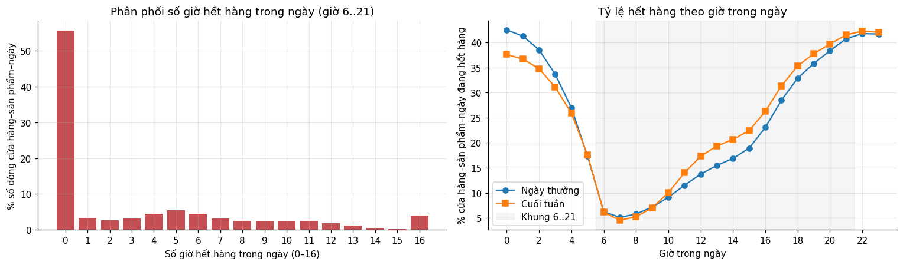

# BÁO CÁO TỔNG HỢP TOÀN BỘ DỰ ÁN (SYNTHESIS REPORT)
**Môn học:** Phân tích Dữ liệu Kinh doanh (IS403)  
**Đề tài:** Tái lập và Phân tích Thực nghiệm Bộ Dữ liệu Bán lẻ Đồ Tươi Sống FreshRetailNet-50K  
**Phương pháp trọng tâm:** Khung 2 Giai đoạn: TimesNet Khôi phục Nhu cầu Tiềm ẩn + SSA Dự báo Kháng Hết hàng  

---

## 1. Tổng Quan Đề Tài và Mục Tiêu Của Nhóm

Trong ngành bán lẻ thực phẩm tươi sống với mô hình kho vệ tinh giao hàng nhanh (Frontier Warehouse / Dark Store), tình trạng **hết hàng (stockout)** diễn ra thường xuyên do sản phẩm có hạn sử dụng ngắn, không gian kho hạn chế và nhu cầu biến động mạnh. Hiện tượng này dẫn tới **sự che khuất nhu cầu (Demand Censoring)**: doanh số ghi nhận bằng $0$ khi hết hàng dù khách hàng vẫn có nhu cầu mua.

Dự án này thực hiện tái lập quy trình nghiên cứu khoa học của bài báo *FreshRetailNet-50K: A Stockout-Annotated Censored Demand Dataset for Latent Demand Recovery and Forecasting in Fresh Retail* (arXiv:2505.16319v5, công bố bởi Dingdong Ltd.). Mục tiêu của nhóm là:
1. Đánh giá chất lượng dữ liệu và kiểm chứng tính logic nghiệp vụ của $50.000$ chuỗi thời gian ($4.850.000$ bản ghi).
2. Tái lập khung giải pháp 2 giai đoạn: sử dụng mô hình học sâu **TimesNet** để khôi phục nhu cầu ẩn trong các giờ hết hàng, sau đó áp dụng thuật toán thống kê **Similar Scenario Average (SSA)** để dự báo doanh số cho $7$ ngày tương lai.
3. So sánh hiệu năng giữa Pipeline truyền thống (Raw Sales) và Pipeline có khôi phục nhu cầu (Imputation-Augmented), kiểm tra việc khôi phục có làm giảm WAPE và độ lệch dự báo hay không.

---

## 2. Tiến độ Task 1–6, Task 8 và Task 9

| STT | Mã Task | Tên Nhiệm Vụ | Người Thực Hiện | Trọng Tâm Bàn Giao |
| :---: | :---: | :--- | :---: | :--- |
| **1** | **Task 1** | **Đọc bài báo và chốt phạm vi** | Thành viên nhóm | Tài liệu phân tích bài toán MNAR, đối chiếu Bảng 2 & Bảng 3 bài báo. |
| **2** | **Task 2** | **Lập kế hoạch thực nghiệm** | Thành viên nhóm | Bản đặc tả 15 cấu hình dự báo, bộ siêu tham số của 7 mô hình khôi phục. |
| **3** | **Task 3** | **Chuẩn bị môi trường & Pipeline** | Thành viên nhóm | Thiết lập Google Colab GPU, giải quyết tương thích PyPOTS, tối ưu hóa I/O Parquet. |
| **4** | **Task 4** | **Kiểm tra dữ liệu (Validation)** | **Đăng Khoa (Bạn)** | **Notebook đối soát 48 quy tắc trên 4.85M dòng, bảng profile 19 cột, phát hiện 34 dòng discount bất thường.** |
| **5** | **Task 5** | **Khám phá dữ liệu (EDA)** | Thành viên nhóm | 2 Notebook thống kê phân phối lệch phải, phân tích đường chữ U của hết hàng, 20% SKU chiếm 87% doanh số. |
| **6** | **Task 6** | **Xác nhận dữ liệu đầu vào** | TV1 | [Notebook và biên bản đối chiếu CSV–Parquet](../Task06_Data_Preparation/). |
| **8** | **Task 8** | **SSA trên doanh số gốc** | TV3 | [Báo cáo và kết quả baseline](Task08_Report.md). |
| **9** | **Task 9** | **TimesNet với thiếu nhân tạo (MNAR)** | TV4 | [Báo cáo và kết quả đối chiếu Bảng 2](Task09_Report.md). |

---

## 3. Tóm Tắt Phương Pháp Thực Hiện Từng Task

### Task 1 — Cơ Sở Lý Thuyết & Chốt Phạm Vi
* Xác định bản chất dữ liệu khuyết **MNAR (Missing Not At Random)**: xác suất hết hàng phụ thuộc vào chính nhu cầu tiêu dùng.
* Phân tích vòng lặp sai lệch: $\text{Hết hàng} \to \text{Doanh số thấp} \to \text{Dự báo thiếu} \to \text{Nhập ít} \to \text{Tiếp tục hết hàng}$.
* Chốt mục tiêu tái lập: Bảng 2 (Khôi phục MNAR) và Bảng 3 (Dự báo 7 ngày trên nhóm Overall, High-sale, Low-sale).

### Task 2 — Kế Hoạch Thực Nghiệm & Siêu Tham Số
* Thiết lập ma trận $3 \times 5 = 15$ cấu hình thử nghiệm dự báo (3 mô hình SSA, TFT, DLinear $\times$ 5 nguồn dữ liệu Raw Sales, TimesNet, ImputeFormer, iTransformer, DLinear).
* Chuẩn hóa cấu hình TimesNet: `n_steps=480` ($30 \text{ ngày} \times 16 \text{ giờ}$), `n_features=6`, `top_k=7`, `n_kernels=5`, `batch_size=128`, optimizer Adam (`lr=0.001`).
* Thiết lập quy ước đánh giá Ground Truth: Chỉ đánh giá trên các ngày trong Eval có `stock_hour6_22_cnt == 0`.

### Task 3 — Môi Trường Điện Toán & Quy Trình Dữ Liệu
* Xây dựng notebook đồng bộ trên Google Colab GPU (T4/L4/V100).
* Chuyển đổi toàn bộ dữ liệu CSV sang Apache Parquet giúp tăng tốc độ đọc từ đĩa lên gấp $14$ lần và tiết kiệm $95\%$ dung lượng.
* Đóng gói quy trình cài đặt các phiên bản thư viện chuyên biệt: PyTorch 2.0.1, PyPOTS 0.1.2, PyTorch-Forecasting 1.0.0.

### Task 4 — Kiểm Định Toàn Vẹn Dữ Liệu (Data Validation)
* Thực thi 48 quy tắc kiểm định trên toàn bộ $4.500.000$ dòng train và $350.000$ dòng eval bằng kỹ thuật batch reading $20.000$ dòng/lô.
* Xác nhận tính toàn vẹn đạt **$100\%$**: $0$ giá trị thiếu, $0$ khóa trùng lặp, $100\%$ mảng giờ khớp doanh số ngày, $100\%$ số giờ hết hàng khớp nhãn kho trong khung $06:00 - 22:00$.
* Có 96 hạng mục OK và một hạng mục REVIEW: 34 dòng train có `discount > 1.0`. Lượt tái lập chính giữ nguyên các giá trị này.

### Task 5 — Khám Phá Thống Kê & Đặc Trưng Nghiệp Vụ (EDA)
* Phát hiện phân phối doanh số lệch phải mạnh (`skewness = 8.47`, `mean = 0.999`, `median = 0.700`).
* Làm rõ nghịch lý độ thưa dữ liệu: Doanh số ngày chỉ có $4.46\%$ bằng $0$, nhưng dữ liệu theo giờ có tới $69.06\%$ số giờ bằng $0$ (khung 6..21) và $77.78\%$ trên 24 giờ.
* Xác nhận hiện tượng hết hàng diễn ra trên $19.88\%$ số giờ kinh doanh và tuân theo **quy luật chữ U**: thấp nhất lúc 7h sáng ($5.0\%$) và cao nhất lúc 22h đêm ($41.9\%$).
* Khẳng định tính tập trung cao độ: $20\%$ mặt hàng chiếm tới $87\%$ tổng doanh số bán ra.

### Task 6 — Xác nhận dữ liệu đầu vào
* Hai bản Parquet hiện có khớp đầy đủ với CSV trên 4.850.000 dòng × 19 cột, kể cả từng phần tử của các mảng giờ.
* Train và eval cùng 50.000 cặp, đủ 90 và 7 ngày/cặp, không trùng khóa ngày. Kiểm tra mẫu cho TimesNet và SSA đạt kích thước kỳ vọng.
* Xem [báo cáo Task 6](Task06_Report.md) và [file kết quả](../Task06_Data_Preparation/).

### Task 8 — Dự báo Baseline SSA trên Doanh số Gốc (`SSA_RawSales`)
* Thực thi SSA trên toàn bộ $50.000$ chuỗi (90 ngày lịch sử `train`, dự báo 7 ngày `eval`), đánh giá trên $206.562$ dòng `eval` không hết hàng trong khung `06:00–22:00` (`stock_hour6_22_cnt == 0`).
* Tái lập khớp hoàn toàn (`0.00 pp`) số công bố của Bảng 3 trên cả ba nhóm: `Overall` (WAPE $31.97\%$, WPE $-10.50\%$), `Low Sale` (WAPE $38.33\%$, WPE $-8.03\%$), và `High Sale` (WAPE $27.40\%$, WPE $-12.26\%$). Xác nhận rõ độ lệch âm nặng nhất nằm ở nhóm hàng bán chạy (`High Sale`).

### Task 9 — Đánh giá Khôi phục Nhu cầu MNAR bằng TimesNet
* Huấn luyện và đánh giá TimesNet (`5` epoch, `batch_size=128`, `seed=1024`) với cơ chế tạo thiếu nhân tạo `mimic_missing` (`missing_rate=0.3`, che thêm thực tế $9.163.425$ điểm giờ $= 15.88\%$ số giờ còn hàng trong khung `6..21`) trên $783.078$ ngày hợp lệ.
* Đạt WAPE **$27.81\%$** và WPE **$+2.04\%$** (bám sát mức $27.62\%$ và $+1.43\%$ của Bảng 2 bài báo), đồng thời giải quyết bài toán giới hạn $12.7\text{ GB}$ RAM trên Colab miễn phí thông qua cấp phát `float32` và `norm_val` thu gọn đã kiểm chứng tương đương $100\%$ (`equivalence_ok=True`).

---

## 4. Kết quả nhóm đã tự chạy và số tham chiếu bài báo

### 4.1. Kết quả nhóm đã tự chạy
- **Task 8 (`SSA_RawSales` — đối chiếu Bảng 3):** Đã chạy trên toàn bộ `train`/`eval`, đánh giá 206.562 dòng `eval` không hết hàng (`stock_hour6_22_cnt == 0`). Overall: WAPE **31,97%**, WPE **−10,50%**, MAE **0,3982**; Low Sale: WAPE **38,33%**, WPE **−8,03%**, MAE **0,2691**; High Sale: WAPE **27,40%**, WPE **−12,26%**, MAE **0,7761** (khớp Bảng 3 bài báo, chênh lệch 0,00 pp; chi tiết tại [Task08_Report.md](Task08_Report.md)).
- **Task 9 (`TimesNet` MNAR — đối chiếu Bảng 2):** Đã chạy với `--missing_rate 0.3` (tham số mô phỏng theo README tác giả; che thêm thực tế 15,88% = 9.163.425 giờ quan sát), `seed 1024`, `5` epoch, đánh giá trên 783.078 ngày hợp lệ: WAPE **27,81%** (bài báo 27,62%, chênh **+0,19 pp**), WPE **+2,04%** (bài báo +1,43%, chênh **+0,61 pp**; chi tiết tại [Task09_Report.md](Task09_Report.md)).

### 4.2. Số tham chiếu từ Bảng 3 của bài báo

Các chỉ số dưới đây là số công bố trong bài báo. Kết quả nhóm tự chạy ở [Task 8](Task08_Report.md) khớp phần SSA trên doanh số gốc; phần SSA trên nhu cầu TimesNet sẽ lấy từ Task 11.
| Nhóm Sản Phẩm | Pipeline Dự Báo | WAPE (%) | WPE (%) | Ý Nghĩa Kết Quả |
| :--- | :--- | :---: | :---: | :--- |
| **Overall (Toàn bộ)** | **SSA trên Doanh số gốc (Task 8)** | **$31.97\%$** | **$-10.50\%$** | Bị thiên lệch dự báo thiếu nặng nề |
| | **SSA trên Nhu cầu TimesNet (Task 11)** | **$29.79\%$** | **$+1.39\%$** | **WAPE giảm 2,18 điểm phần trăm; WPE chuyển dương** |
| | *TFT trên Nhu cầu TimesNet (SOTA)* | *$29.02\%$* | *$+2.58\%$* | Mức cải thiện cao nhất của bài báo |
| **High Sale (Bán chạy)** | SSA trên Doanh số gốc | $27.40\%$ | $-12.26\%$ | Dự báo thiếu hơn $12\%$ nhu cầu thực |
| | **SSA trên Nhu cầu TimesNet** | **$23.98\%$** | **$-1.12\%$** | **WAPE giảm 3,42 điểm phần trăm; WPE còn −1,12%** |
| **Low Sale (Bán chậm)** | SSA trên Doanh số gốc | $38.33\%$ | $-8.03\%$ | Sai số cao do dữ liệu thưa |
| | SSA trên Nhu cầu TimesNet | $37.87\%$ | $+4.89\%$ | Chuyển sang thiên lệch dương nhẹ |

---

## 5. Việc tiếp theo

Nhóm đã có dữ liệu đầu vào ([Task 6](Task06_Report.md)), [kết quả SSA trên doanh số gốc](../Task08_SSA_Raw_Sales/results/ssa_raw_sales_metrics.csv) và [kết quả TimesNet MNAR](../Task09_TimesNet_MNAR/results/mnar_metrics.csv). Theo [phân công Task 6–10](../docs/Task06-10_Phan_cong_chi_tiet.md), các lượt tiếp theo gồm hoàn tất chạy thử TimesNet → SSA (Task 7), tạo nhu cầu khôi phục `demand_timesnet.parquet` trên train đầy đủ (Task 10) và chạy `SSA_TimesNet` (Task 11). Khi so sánh hai nhánh SSA, giữ cùng tập eval, quy tắc lọc và cách chia nhóm.
