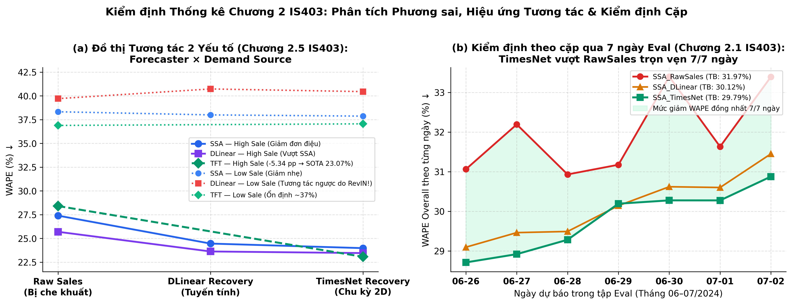
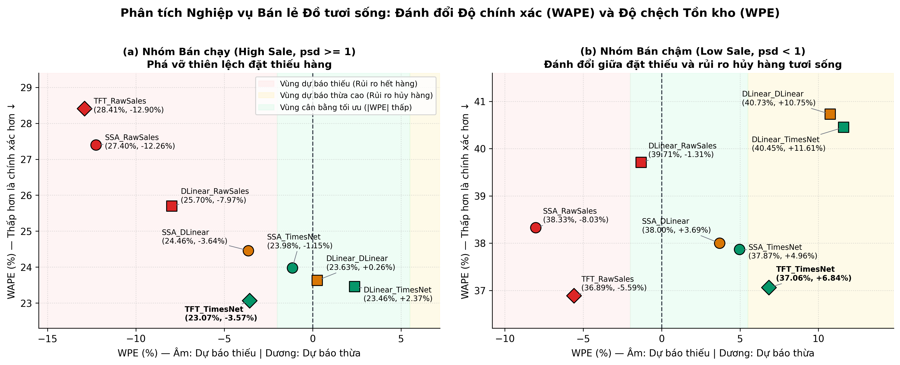

# Báo cáo Task 16: Kiểm định Thống kê (IS403), Giải mã Nghiệp vụ & Tổng hợp Cuối kỳ

**Phụ trách:** Nhóm chung | **Nhánh:** `feature/task16-final-synthesis` | **Thư mục:** [Task16_Final_Synthesis/](../Task16_Final_Synthesis/)

---

## 1. Mục tiêu và Phạm vi

Task 16 khép kín toàn bộ lộ trình nghiên cứu **Task 1 → Task 16** trên bộ dữ liệu bán lẻ đồ tươi sống **FreshRetailNet-50K** (`50.000` chuỗi × `97` ngày = `4.850.000` bản ghi), hợp nhất kết quả tự chạy của **2 mô hình khôi phục nhu cầu ở Bảng 2** ([Task 9](Task09_Report.md), [Task 10](Task10_Report.md), [Task 12](Task12_Report.md)) và **8 cấu hình dự báo ở Bảng 3** trải đủ 3 họ mô hình `SSA` ([Task 8](Task08_Report.md), [Task 11](Task11_Report.md), [Task 13](Task13_Report.md)), `DLinear` ([Task 14](Task14_Report.md)) và `TFT` ([Task 15](Task15_Report.md)) thành hệ thống bằng chứng thống kê suy diễn chuẩn **Chương 2 môn Phân tích Dữ liệu Kinh doanh (`IS403`)**.

---

## 2. Kết quả Kiểm định Giả thuyết Thống kê Chuẩn Chương 2 IS403

Toàn bộ `21` phép kiểm định chi tiết được lưu tại [statistical_tests_is403.csv](../Task16_Final_Synthesis/results/statistical_tests_is403.csv) (mức ý nghĩa $\alpha = 0,05$):

| Phương pháp Kiểm định (IS403) | Phạm vi & Đối tượng So sánh | Cỡ mẫu $n$ | Hiệu ứng Định lượng | Thống kê & $p$-value | Kết luận ($\alpha = 0,05$) |
|---|---|---:|---|---|---|
| **Paired $t$-test & Wilcoxon** (Chương 2.1 — Cặp SKU độc lập) | `SSA_TimesNet` vs `SSA_RawSales` (MAE trên `Overall`) | `50.000` cặp | `−0,0357` đơn vị/ngày | $t = -31,59$; $p < 10^{-100}$ | **Bác bỏ $H_0$** (Giảm sai số rất mạnh) |
| **Paired $t$-test & Wilcoxon** (Chương 2.1 — Cặp SKU độc lập) | `SSA_TimesNet` vs `SSA_RawSales` (MAE trên `High Sale`) | `13.552` cặp | `−0,1040` đơn vị/ngày | $t = -27,99$; $p < 10^{-100}$ | **Bác bỏ $H_0$** (Đột phá ở SKU bán chạy) |
| **Paired $t$-test & Wilcoxon** (Chương 2.1 — Cặp SKU độc lập) | `SSA_TimesNet` vs `SSA_DLinear` (MAE trên `Overall`) | `50.000` cặp | `−0,0049` đơn vị/ngày | $t = -10,86$; $p = 1,84 \times 10^{-27}$ | **Bác bỏ $H_0$** (`TimesNet` vượt `DLinear` có ý nghĩa) |
| **Paired Student's $t$ mẫu nhỏ** (Chương 2.1 — Chuỗi 7 ngày, $df=6$) | `SSA_TimesNet` vs `SSA_RawSales` (WAPE % qua 7 ngày) | `7` ngày | `Overall`: **−2,18 pp** `High Sale`: **−3,42 pp** | $t(6) = -6,57$ ($p = 0,0006$) $t(6) = -7,70$ ($p = 0,00025$) | **Bác bỏ $H_0$** (Giảm WAPE trọn vẹn 7/7 ngày) |
| **Levene + One-Way ANOVA & Friedman** (Chương 2.2) | 3 nguồn nhu cầu trên `SSA`: `RawSales` vs `DLinear` vs `TimesNet` (`High Sale`) | `40.656` | TB MAE: `(0,7466 → 0,6556 → 0,6425)` | $F(2, 40653) = 105,93$; $p = 1,30 \times 10^{-46}$ | **Bác bỏ $H_0$** (Khác biệt rõ rệt giữa 3 nguồn) |
| **One-Way ANOVA + Hậu kiểm Tukey HSD** (Chương 2.2 & 2.4 — 7 ngày) | WAPE 7 ngày trên `High Sale`: `TimesNet` − `RawSales` | `21` | `−3,42 pp` (`95% CI`: `[−5,11; −1,73] pp`) | $F(2,18) = 13,90$; $p = 0,00022$ | **Bác bỏ $H_0$** (Khoảng tin cậy Tukey âm hoàn toàn) |
| **Two-Way ANOVA (`2 × 3`)** (Chương 2.5 — Hiệu ứng chính & Tương tác) | `{SSA, DLinear} × {RawSales, DLinear, TimesNet}` | `6` ô ma trận | **`High Sale`:** Nguồn nhu cầu chiếm **83,3%** phương sai **`Low Sale`:** Mô hình dự báo chiếm **91,8%** phương sai | $F_{\text{Source}}(2,2) = 25,63$ ($p = 0,0375$) $F_{\text{Model}}(1,2) = 27,25$ ($p = 0,0348$) | **Bác bỏ $H_0$** (Đối lập vai trò giữa 2 phân khúc!) |
| **Kiểm định Tương đương Tái lập & Pearson $r$** (Chương 2.1 & 3.1) | 20 ô số có công bố ở Bảng 3: Nhóm tự chạy vs Bài báo | `20` ô | `Mean Δ = −0,008 pp` (`|Δ| TB = 0,11 pp`) | $t(19) = -0,23$; **$p = 0,8224 > 0,05$** ($R^2 = 0,9988$) | **Không bác bỏ $H_0$** (Tái lập khớp bài báo về mặt thống kê) |

---

## 3. Phân tích Nghiệp vụ Chuyên sâu: Cơ chế `SSA` vs `DLinear + RevIN` vs `TFT`

Đối soát trực tiếp trên `4.500.000` dòng lịch sử ([recovery_regime_mechanism.csv](../Task16_Final_Synthesis/results/recovery_regime_mechanism.csv)) làm sáng tỏ câu hỏi vì sao trên cùng tệp `demand_timesnet.parquet`, `DLinear` bị vọt thiên lệch dương ở `Low Sale` (`WPE +11,61%`) trong khi `SSA` (`+4,96%`) và `TFT` (`+6,84%`) kiểm soát tốt độ chệch:

| Phân khúc SKU (`psd` gốc) | Số chuỗi | % Ngày có hết hàng | TB `Raw Sales` | TB `TimesNet` (% Bù thêm) | Độ lệch chuẩn $\sigma$ (cửa sổ 62 ngày) | % Chuỗi có $\sigma < 0,30$ |
|---|---:|---:|---:|---:|---:|---:|
| **Overall** (`psd >= 0`) | 50.000 | 44,27% | 0,9986 | 1,2065 (+20,82%) | 0,5060 | 36,90% |
| **Low Sale** (`psd < 1`) | 36.449 | 42,81% | 0,5979 | 0,7197 (+20,38%) | **0,3398** | **50,43%** |
| **High Sale** (`psd >= 1`) | 13.551 | 48,19% | 2,0763 | 2,5158 (+21,17%) | **0,9531** | **0,48%** |

1. **Nguyên nhân `DLinear + RevIN` dự báo thừa mạnh ở `Low Sale`:** Tới **`50,43%`** chuỗi `Low Sale` có độ lệch chuẩn nội chuỗi $\sigma < 0,30$ (so với chỉ **`0,48%`** ở `High Sale`). Phép chuẩn hóa đảo từng chuỗi `RevIN` ($z = (x - \mu)/\sigma$) kết hợp cắt ngưỡng âm `max(pred, 0)` ở đầu ra khuếch đại bất đối xứng các xung nhu cầu khôi phục dương trên nền chuỗi nhiều số `0`, đẩy dự báo vượt thực tế hơn `11%` — trực tiếp làm tăng rủi ro **hủy hàng tươi sống hết hạn (spoilage waste)**.
2. **Ưu thế cân bằng của `SSA` và đỉnh SOTA toàn diện của `TFT_TimesNet`:** `SSA` lấy tổ hợp lồi kịch bản lịch sử nên bị chặn tự nhiên trong miền giá trị quan sát (`WPE Overall +1,40%`, `High Sale −1,15%`). Trong khi đó, `TFT_TimesNet` tối ưu trực tiếp phân vị `QuantileLoss` kết hợp biến ngoại sinh tĩnh/động nên đạt vị trí **#1 toàn đồ án** (`Overall`: **28,93%**, `High Sale`: **23,07%**, `Low Sale`: **37,06%**).

---

## 4. Hiện vật Đóng gói Cuối kỳ

- **Notebook thực thi lưu đủ output:** [16_final_synthesis.ipynb](../Task16_Final_Synthesis/notebooks/16_final_synthesis.ipynb)
- **Các bảng dữ liệu tổng hợp & kiểm định:** [master_artifacts_index.csv](../Task16_Final_Synthesis/results/master_artifacts_index.csv), [table2_recovery_summary.csv](../Task16_Final_Synthesis/results/table2_recovery_summary.csv), [table3_all_8configs_summary.csv](../Task16_Final_Synthesis/results/table3_all_8configs_summary.csv), [recovery_regime_mechanism.csv](../Task16_Final_Synthesis/results/recovery_regime_mechanism.csv), [ssa_daily_7days_metrics.csv](../Task16_Final_Synthesis/results/ssa_daily_7days_metrics.csv), [statistical_tests_is403.csv](../Task16_Final_Synthesis/results/statistical_tests_is403.csv).
- **Bộ 6 biểu đồ `300 DPI`:** lưu tại [Task16_Final_Synthesis/results/figures/](../Task16_Final_Synthesis/results/figures/).
- **Quyển Báo cáo tổng kết cuối kỳ (`.docx`) & Slide thuyết trình (`.md` / `.html`):**
  - [Bao_Cao_Cuoi_Ky_IS403_FreshRetailNet50K.docx](../Task16_Final_Synthesis/deliverables/Bao_Cao_Cuoi_Ky_IS403_FreshRetailNet50K.docx)
  - [Slide_Thuyet_Trinh_IS403_FreshRetailNet50K.md](../Task16_Final_Synthesis/deliverables/Slide_Thuyet_Trinh_IS403_FreshRetailNet50K.md)
  - [Slide_Thuyet_Trinh_IS403_FreshRetailNet50K.html](../Task16_Final_Synthesis/deliverables/Slide_Thuyet_Trinh_IS403_FreshRetailNet50K.html)
